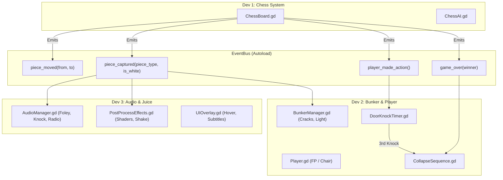

# Дизайн-документ (GDD) и 72-часовой план: «Белый Король» (White King)

> **Жанр**: Психологический триллер / Шахматная антивоенная драма  
> **Движок**: Godot 4 (3D Forward+)  
> **Формат**: 72-часовой гейм-джем  
> **Команда**: 3 программиста (0 художников)  
> **Ключевая эмоция**: Нарастающая тревога, клаустрофобия, осознание соучастия и неизбежности катастрофы.

---

## 1. High Concept & Метафора

Игрок — главнокомандующий, запертый в сером железобетонном бункере. Единственный предмет в центре комнаты — деревянный стол с шахматами, над которым нервно мигает лампа. 

Игрок играет одну партию в шахматы против безликой войны (черные фигуры перемещаются сами со зловещим скрежетом). Каждая взятая фигура с любой стороны означает тысячи смертей и приближение фронта к бункеру. 

> [!IMPORTANT]
> **Главная мысль**: Война уничтожает всё вокруг независимо от того, кто «побеждает» на доске. Если пытаться выиграть — мир сгорает дотла. Если бездействовать — враг выбивает дверь бункера. В финале игрок обнаруживает, что он сам лишь такая же фигура на доске.

---

## 2. Игровой цикл и механики

### 2.1. Передвижение и ракурсы
- **Свободный режим (Walk mode)**: Вид от первого лица (`WASD` + мышь). Игрок может обойти комнату 5x5 метров, подойти к массивной стальной двери, радиоприемнику на тумбе или трещинам в стенах.
- **Режим доски (Board mode)**: При приближении к столу и нажатии `E` (или ЛКМ) камера плавно (`Tween`) интерполируется в фиксированный вид сверху-сбоку над доской. Появляется мышиный курсор, подсвечиваются возможные ходы выбранной фигуры.
- **Выход из-за стола**: Нажатие `Space` / `Esc` / `ПКМ` плавно возвращает управление в режим ходьбы.

### 2.2. Шахматный движок и ИИ
- **Формат**: 1 быстрая партия (10–15 ходов до кульминации).
- **Поведение ИИ**: Упрощенный минимакс с акцентом на **жадные агрессивные размены**. ИИ провоцирует частые захваты фигур, чтобы ускорить деградацию комнаты.
- **Вспомогательные системы**: Подсветка доступных клеток для хода зеленым/белым, подсветка фигуры под боем красным.

### 2.3. Механика бездействия (The Knock)
- Если игрок сидит и не делает ход дольше **25 секунд**:
  1. **Первый стук (25 сек)**: Одиночный глухой удар снаружи в стальную дверь бункера. Пыль с потолка, затухание звука.
  2. **Второй стук (45 сек)**: Серия яростных ударов в дверь, звон дверных петель, лампа раскачивается.
  3. **Третий стук (60 сек)**: Дверь с грохотом вылетает с петель, комната заполняется дымом и тьмой — поражение (штурм бункера).
- Каждый сделанный ход сбрасывает таймер стука (война временно «занята» ходом).

### 2.4. Эскалация комнаты (4 стадии разрушения)
Счетчик потерь = сумма всех съеденных белых и черных фигур:

| Стадия | Потери (фигур) | Визуальные изменения | Аудио-окружение |
|---|---|---|---|
| **I. Затишье** | 0 – 3 | Чистый бетон, ровный свет лампы, легкое мерцание. | Гул трансформатора, тиканье настенных часов. |
| **II. Тревога** | 4 – 7 | Появление сетки мелких трещин на штукатурке, частицы пыли в воздухе. | Далекие низкочастотные глухие разрывы снаружи, щелчки радио. |
| **III. Осада** | 8 – 11 | Глубокие трещины, лампа раскачивается по синусоиде, красный аварийный свет пробивается сквозь вентиляцию, сильная тряска экрана при взятии фигур. | Вой сирен за стенами, яростные радиопереговоры («Батальон уничтожен!»), скрежет металла. |
| **IV. Коллапс** | 12+ (или мат) | Стены бункера трескаются насквозь и медленно распадаются/опускаются вниз. | Абсолютный вакуум звука, переходящий в похоронный колокол и свист ветра. |

### 2.5. Кульминация (Финал)
Когда на доске ставится мат (или взят один из королей):
1. Камера принудительно встает из-за стола.
2. Вся геометрия четырех стен бункера падает наружу (или растворяется шейдером растворения).
3. Игрок видит, что он стоит посреди бесконечной выжженной пустыни на гигантской черной/белой шахматной плитке. Вокруг — горящие силуэты других шахматных фигур.
4. Титр: *«В войне нет победителей. Есть только пустая доска.»*

---

## 3. Арт-дирекшн без художников (Godot 4)

Вместо текстурирования и сложного 3D-моделирования ставка делается на **брутализм, кинематографичный свет и пост-процессинг**:

```
[Атмосфера бункера]
- Геометрия: Godot CSGBox3D (комната, проем двери, стол).
- Шахматы: Бесплатный CC0 low-poly пак (Kenney или KayKit) с единым материалом (мрамор/черный обсидиан).
- Освещение: 
    * 1 OmniLight3D (над столом с мягкими тенями Shadows Enabled, PCF5).
    * Скриптовое мерцание и раскачивание источника света.
    * WorldEnvironment: Volumetric Fog (объемная дымка), SSAO, Glow, Color Correction (холодный десатурированный LUT).
- Шейдеры (Dev 3): 
    * Экранный Film Grain (зернистость пленки).
    * Хроматическая аберрация и Vignette при росте тревоги.
    * Screen Shake при взятии фигур и ударах в дверь.
```

---

## 4. Архитектура проекта: Signal Bus (Свобода от git-конфликтов)

Чтобы 3 разработчика не конфликтовали в Git, игра строится вокруг единого синглтона `EventBus.gd`:



---

## 5. Роли и зоны ответственности

### **Dev 1: Шахматная механика и ИИ**
- [ ] Хранение доски 8x8 (матрица фигур и правил ходов).
- [ ] Выбор фигуры по клику мыши, генерация легальных клеток, выполнение хода.
- [ ] Скрипт простого ИИ (эвристика: взять фигуру > напасть на фигуру > случайный легальный ход).
- [ ] Анимация плавного перемещения фигур (Tween скрежета по доске).
- [ ] Эмиссия сигналов в `EventBus` (`piece_captured`, `piece_moved`, `game_over`).

### **Dev 2: Игрок, Комната и Разрушение**
- [ ] Сборка базовой локации бункера (CSGBox3D, стальная дверь, лампа на проводе).
- [ ] Контроллер от первого лица (`CharacterBody3D`) с переходом в режим стула (`Camera3D Tween`).
- [ ] Логика таймера бездействия (`DoorKnockTimer`): 3 стадии стука в дверь.
- [ ] Механизм разрушения бункера (появление декалей трещин на стенах, осыпание частиц пыли `GPUParticles3D`).
- [ ] Скрипт финального коллапса: анимация падения стен и показ пустоты.

### **Dev 3: Звук, Шейдеры, Сок (Juice) и UI**
- [ ] Звуковое оформление (подбор CC0 звуков): глухой стук дерева, скрежет металла, мощный удар в дверь, шипение радио, низкий бас взрывов.
- [ ] Шейдеры постобработки: хроматическая аберрация, зернистость, виньетка.
- [ ] Скрипт тряски камеры (`CameraShake3D`) с разной амплитудой под разные события.
- [ ] Текстовые радио-сводки (короткие жуткие субтитры внизу экрана при взятии фигур).
- [ ] Главное меню, экран завершения и сборка релизного билда (HTML5 / Windows / Linux).

---

## 6. Почасовой план 72-часового спринта

```
[День 1: Фундамент (0-24 ч)]
├── Dev 1: Сетка доски 8x8, правила ходов пешек/фигур, клик и подсветка клеток.
├── Dev 2: 3D-комната (стены, стол, лампа), контроллер первого лица + вход/выход из-за стола.
└── Dev 3: Настройка WorldEnvironment (туман, свет), прототип EventBus, заготовка аудио-банка.
ИТОГ ДНЯ 1: Игрок ходит по комнате, садится за стол и может сделать первый ход белыми.

[День 2: Интеграция и эскалация (24-48 ч)]
├── Dev 1: ИИ черных с агрессивным разменом, взятие фигур, Tween-скрежет черных фигур.
├── Dev 2: Трещины на стенах, таймер бездействия (стук в дверь), реакция лампы на ходы.
└── Dev 3: Радио-сводки на взятия, тряска камеры при ударах, экранные эффекты тревоги.
ИТОГ ДНЯ 2: Полный игровой цикл: играешь партию, за дверью стучат при паузах, комната трясется.

[День 3: Финал, полишинг и билд (48-72 ч)]
├── Общее: Сборка финального коллапса стен (падение бункера и показ шахматной пустоты).
├── Dev 1: Защита от дурака (пат, недопустимые ходы), баланс агрессии ИИ.
├── Dev 2: Детализация бункера (провода, вентиляция, мерцание света, титры).
├── Dev 3: Финальный звуковой микс, полишинг UI, экспорт билда (Windows + Web) и заливка на itch.io.
ИТОГ ДНЯ 3: Готовая, оттестированная и отправленная на джем игра.
```

