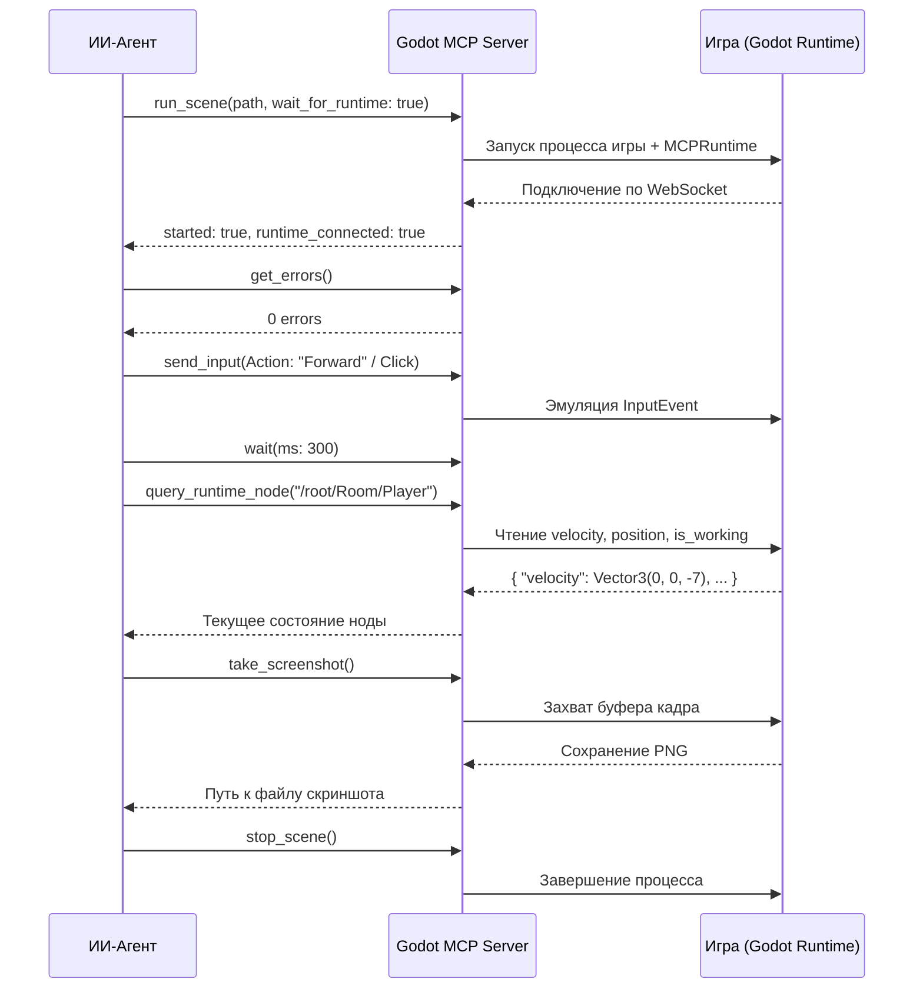

# Руководство по взаимодействию с Godot MCP сервером

> **Статус**: Сервер активен в live-режиме (`ws://127.0.0.1:6505`).  
> **Плагин**: `res://addons/godot_mcp/` (включен в `project.godot`).  
> **Runtime Helper**: Autoload `MCPRuntime` (активен во время `run_scene`).

Godot MCP позволяет ИИ-агентам и разработчикам управлять редактором Godot и запущенной игрой напрямую через вызовы MCP инструментов, минуя ручные рутинные действия в интерфейсе.

---

## 1. Проверка статуса соединения

Перед началом работы агент всегда может проверить состояние редактора:

```json
// Вызов инструмента: get_godot_status
{}
```
**Ответ содержит**:
- `connected: true/false` — статус веб-сокет соединения с редактором Godot.
- `mode: "live"` — редактор открыт и готов к выполнению команд.
- `project_path` — путь к открытому проекту.

Если файлы скриптов или ресурсов были изменены на диске внешними средствами, вызовите:
```json
// Вызов инструмента: rescan_filesystem
{}
```
Это заставляет редактор Godot мгновенно пересканировать дерево файлов без перезапуска.

---

## 2. Разработка и валидация скриптов (GDScript)

### Валидация синтаксиса перед коммитом
Любой измененный или созданный скрипт обязательно валидируется через движок:
```json
// Вызов инструмента: validate_script
{
  "path": "res://scripts/event_bus.gd"
}
```
**Результат**: Godot компилирует скрипт в памяти и возвращает точные строки ошибок и предупреждений (типизация, синтаксис, несуществующие свойства).

### Запрос документации ClassDB
Если агенту нужно узнать сигнатуру метода, параметры сигнала или список свойств встроенного класса Godot:
```json
// Вызов инструмента: classdb_query
{
  "class_name": "Camera3D",
  "query_type": "all" // "methods" | "properties" | "signals"
}
```

---

## 3. Инспекция и редактирование 3D/2D сцен

### Просмотр дерева сцены
Чтобы увидеть актуальную структуру нод открытой сцены:
```json
// Вызов инструмента: scene_tree_dump
{}
```
Либо прочитать структуру любой сцены с диска:
```json
// Вызов инструмента: read_scene
{
  "path": "res://scenes/room.tscn"
}
```

### Добавление и настройка нод
1. **Создание ноды**:
   ```json
   // Вызов: add_node
   {
     "scene_path": "res://scenes/bunker/bunker_room.tscn",
     "parent_path": ".",
     "node_type": "CSGBox3D",
     "node_name": "Table"
   }
   ```
2. **Установка свойств ноды**:
   ```json
   // Вызов: set_node_properties
   {
     "scene_path": "res://scenes/bunker/bunker_room.tscn",
     "node_path": "Table",
     "properties": {
       "size": "Vector3(1.5, 0.8, 1.0)",
       "position": "Vector3(0, 0.4, 0)"
     }
   }
   ```
3. **Инстанцирование под-сцены**:
   ```json
   // Вызов: instance_scene
   {
     "target_scene_path": "res://scenes/room.tscn",
     "parent_node_path": ".",
     "instance_scene_path": "res://scenes/chess/chess_table.tscn",
     "instance_name": "ChessTable"
   }
   ```
4. **Управление Autoload (синглтонами)**:
   ```json
   // Вызов: setup_autoload
   {
     "operation": "add", // "add" | "remove" | "list"
     "name": "EventBus",
     "path": "res://scripts/event_bus.gd"
   }
   ```

---

## 4. Живой цикл тестирования игры (Runtime Testing Loop)

Благодаря встроенному `MCPRuntime` агент может запустить игру, управлять вводом игрока, проверять переменные нод и делать скриншоты.



### Пошаговый рецепт тестирования:

#### Шаг 1. Запуск сцены с блокировкой до инициализации
```json
// Вызов инструмента: run_scene
{
  "scene_path": "res://scenes/room.tscn",
  "wait_for_runtime": true
}
```
*Важно*: `wait_for_runtime: true` гарантирует, что следующий вызов не упадет с ошибкой "Runtime helper not connected".

#### Шаг 2. Проверка ошибок старта
```json
// Вызов инструмента: get_errors
{
  "max_errors": 20
}
```

#### Шаг 3. Симуляция действий игрока (`send_input`)
- **Нажатие клавиши действия (Action из InputMap)**:
  ```json
  // Вызов инструмента: send_input
  {
    "event": {
      "type": "action",
      "action": "Forward",
      "pressed": true
    }
  }
  ```
- **Клик мыши (выбор шахматной фигуры)**:
  ```json
  // Вызов инструмента: send_input
  {
    "event": {
      "type": "mouse_button",
      "button_index": 1,
      "pressed": true,
      "position": { "x": 960, "y": 540 }
    }
  }
  ```
- **Пауза между действиями**:
  ```json
  // Вызов инструмента: wait
  {
    "ms": 250
  }
  ```

#### Шаг 4. Чтение значений переменных в работающей игре
```json
// Вызов инструмента: query_runtime_node
{
  "node_path": "/root/EventBus",
  "properties": ["total_losses", "current_stage", "is_in_board_mode"]
}
```
Инструмент возвращает реальные значения свойств, измененные логикой игры!

#### Шаг 5. Снятие скриншота
```json
// Вызов инструмента: take_screenshot
{}
```
Возвращает абсолютный путь к PNG-изображению экрана запущенной игры. Агент и разработчик могут визуально оценить свет, туман, интерфейс или шейдеры.

#### Шаг 6. Мониторинг производительности и утечек
```json
// Вызов инструмента: get_performance_monitors
{}
```
Проверяет:
- `fps` (целевой фреймрейт 60+)
- `draw_calls` (критично для 3D Forward+)
- `orphan_nodes` (контроль утечек памяти при спавне/удалении фигур)

#### Шаг 7. Остановка сцены
```json
// Вызов инструмента: stop_scene
{}
```
Останавливает игровой процесс перед внесением изменений в код или файлы сцены.

---

## 5. Пакетные операции и Undo/Redo

Если требуется выполнить серию изменений нод (например, расставить 64 клетки шахматной доски):
- Используйте `batch_execute` (`mode: "atomic"`). Если хотя бы одна операция упадет, все предыдущие будут откатаны.
- Для отката ошибочных изменений нод доступны инструменты:
  - `mcp_undo`
  - `mcp_redo`
  - `mcp_undo_history`

---

## 6. Частые ошибки и их устранение

| Ошибка | Причина | Решение |
|---|---|---|
| `"Runtime helper not connected"` | `take_screenshot` или `send_input` вызван до готовности рантайма. | Всегда передавайте `"wait_for_runtime": true` в вызове `run_scene`. |
| `"Unknown action '...' in send_input"` | Действие не объявлено в `InputMap`. | Проверьте зарегистрированные действия через `get_input_map`. |
| Редактор не видит новый скрипт | Файл создан агентом напрямую в ОС. | Вызовите `rescan_filesystem`. |
| Ошибка доступа при редактировании сцены | Сцена сейчас запущена в игре. | Сначала вызовите `stop_scene()`, затем редактируйте. |

